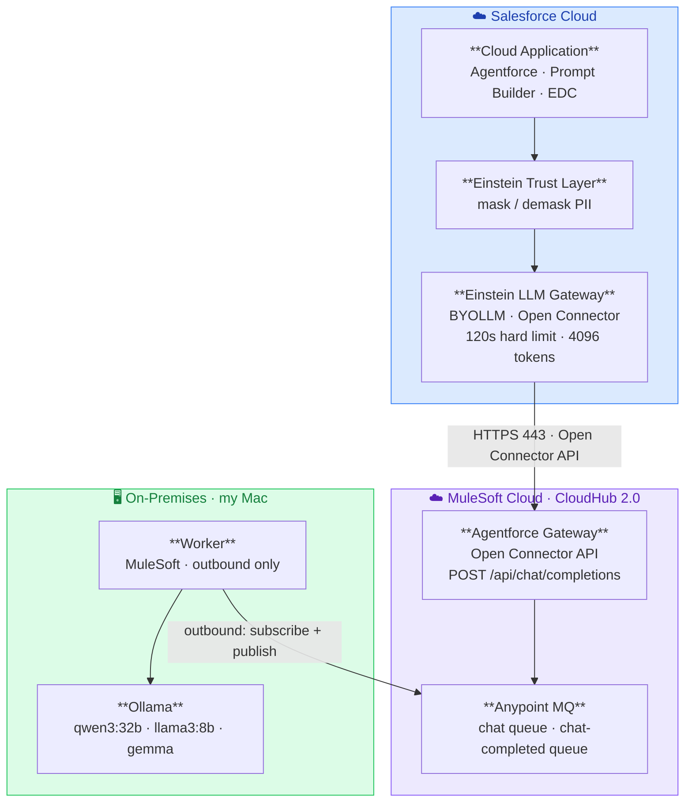

# Agentforce On-Prem LLM Gateway — Architecture (async model)

End-to-end flow. Salesforce never reaches into on-premise — the Worker connects **outbound**
only, so the old DMZ layer (Akamai CDN + nginx reverse proxy) is no longer needed.

## Flow

1. **Cloud Application** (Agentforce / Prompt Builder) invokes the model.
2. **Einstein Trust Layer** masks PII on the way out (and demasks on the way back).
3. **Einstein LLM Gateway** (BYOLLM / Open Connector) dispatches the request over HTTPS 443
   to the registered Open Connector endpoint — the **Agentforce Gateway**. The 120s / 4096-token
   limits live here.
4. **Agentforce Gateway** (CloudHub 2.0) publishes the request to **Anypoint MQ** and polls for
   the correlated response (`taskId`).
5. **Worker** (on-prem) connects **outbound** to Anypoint MQ — subscribes to `chat`, publishes to
   `chat-completed` — and calls **Ollama** locally on my Mac.
6. Response flows back the same path, demasked by the Trust Layer before Agentforce sees it.

## What the async model removes

The synchronous design required Salesforce to reach *into* on-premise, which is why the DMZ
existed. In the async model that inbound leg is gone:

- ❌ **Akamai CDN** (SF egress-IP whitelist, TLS termination) — no inbound from SF to secure.
- ❌ **nginx reverse proxy** (routing, TLS to backend) — model routing moves into the Worker.
- ❌ **Inbound firewall openings** to `llm.internal.example.com` — the Worker dials out over 443 instead.

**Carried over unchanged** (Salesforce-side, not network-layer): the **120s hard limit** and
**4096-token** cap on the Einstein LLM Gateway, and **PII masking** by the Einstein Trust Layer.
